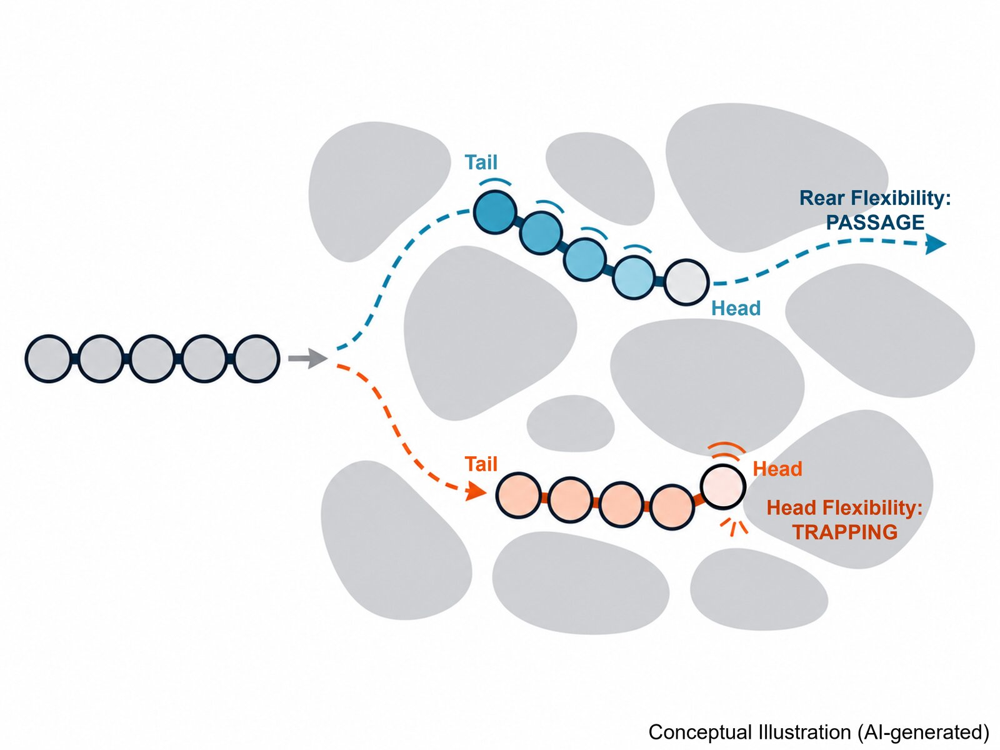

**Lab:** Microfluids & Soft Matter Laboratory, SNU (Prof. Ho-Young Kim)  
**Period:** Sep. 2025 – Present  
**Award:** Grand Prize, Creative Design Festival, Research Division — College of Engineering, Seoul National University (Sep. 2026)

Link-bots are chain-like robots made of rigid units connected by joints. When such a robot moves through a cluttered, porous environment, the same body that lets it squeeze through gaps can also get it stuck. This project asks how the design of the chain and the geometry of its surroundings together decide whether it passes through or becomes trapped.

**What I did**
* Built a five-unit link-bot chain and systematically varied its geometric parameters
* Varied the spacing between obstacles in an obstacle array to see how the environment shapes mobility
* Explored how chain design and obstacle spacing together affect mobility

Part of this work was presented as a poster at [IEEE MIT URTC 2026](/talks/). A manuscript is in preparation, and detailed results will be shared upon publication.
