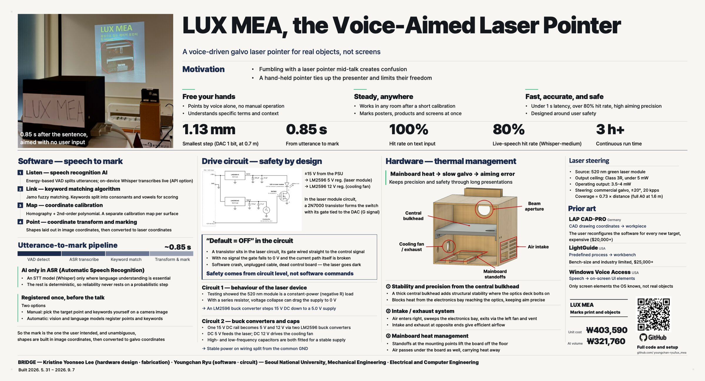

<small>Click the poster to view it full size.</small>

**Award:** Bronze Prize, Creative Design Festival, Creative Project Division — College of Engineering, Seoul National University (Sep. 2026)  
**Team:** Kristine Yoonseo Lee (hardware design & fabrication), Youngchan Ryu (software & circuit)  
**Period:** May 2026 – Sep. 2026

A hand-held laser pointer ties up the presenter's hand, and fumbling with it mid-talk breaks the flow. LUX MEA is a galvo laser pointer that aims at real objects — posters, products, or screens — when the presenter simply names them out loud.

**How it works**
* **Listen:** voice-activity detection splits speech into utterances, and an on-device Whisper model transcribes them
* **Link:** fuzzy keyword matching connects the spoken words to targets registered before the talk
* **Map & point:** a homography with a second-order polynomial correction converts each target to galvo coordinates, and the laser marks it

**What I did**
* Designed and fabricated the hardware enclosure around thermal stability: heat from the mainboard slows the galvo and causes aiming error during long presentations
* Added a central bulkhead that separates the optics from the electronics, an intake/exhaust airflow path, and standoffs that lift the mainboard off the floor of the case

**Results**
* 0.85 s from the end of a sentence to the laser mark
* 80% hit rate on live speech, 100% on text input
* 1.13 mm smallest aiming step at 0.7 m, and over 3 hours of continuous operation

**Code:** Full code and setup are available on [GitHub](https://github.com/youngchan-ryu/lux_mea).
