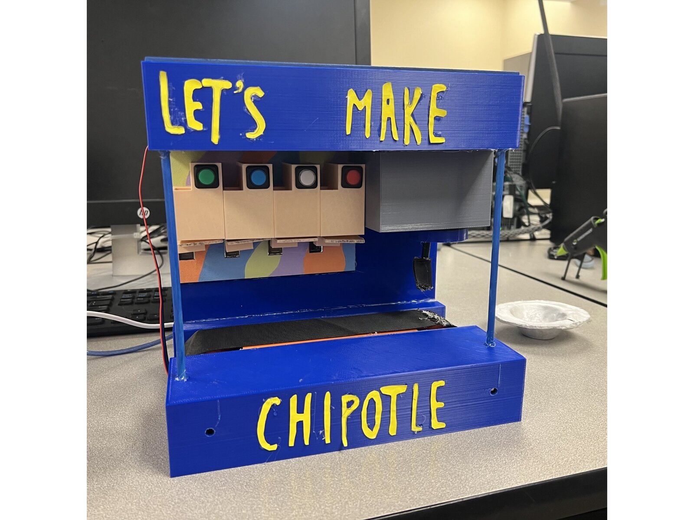

**Course:** ME 444 Computer-Aided Design and Prototyping — Purdue University (Spring 2025)  
**Team:** 4 members

A desktop action toy that builds a Chipotle-style bowl automatically. The bowl travels along a line of ingredient stations, picks up each ingredient in turn, and the ingredients are mixed at the end.

**How it works**
* Pressing a colored button opens the matching ingredient compartment, and the ingredient drops into the bowl
* A spur gear mechanism and a stepper-motor-driven timing belt move the bowl from station to station
* At the final station, the collected ingredients are mixed

**What I did**
* Led the hardware and electronics work for the team

  

    <iframe src="https://www.youtube.com/embed/Uxo2HaRPbyI" title="Let's Make Chipotle demo" style="position: absolute; top: 0; left: 0; width: 100%; height: 100%; border: 0;" allowfullscreen></iframe>
  

