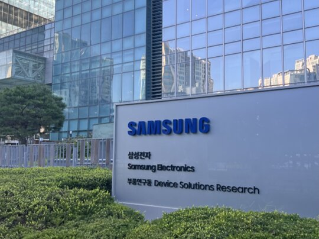

**Program:** Samsung Talent Internship Program — Equipment Technology Research Institute, Samsung Electronics (Jul. 2024 – Aug. 2024)  
**Award:** Certificate for the Most Outstanding Completer, Samsung Talent Internship Program — Samsung Electronics Device Solutions (Aug. 2024)

Pipes in semiconductor fabrication facilities change in diameter along their length, so a cleaning robot that travels inside them has to keep contact with the pipe wall as the size changes.

**What I did**
* Designed a wheel mechanism that uses a torsion spring structure to adapt passively to changing pipe diameters

*Details are omitted due to confidentiality.*
