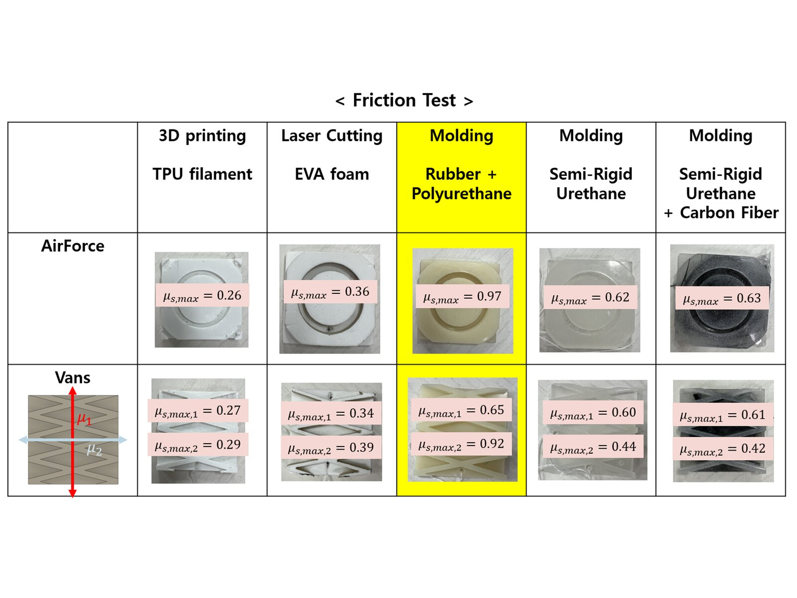

**Award:** Outstanding Materials and Manufacturing Processes Award, 2024 MMP Contest — Department of Mechanical Engineering, Seoul National University (Jun. 2024)  
**Team:** 6 members, Materials and Manufacturing Processes course project

Slippers and worn shoes are a common cause of falls on wet floors and stairs. We set out to design a shoe sole that is less slippery and more durable.

**Approach**
* Reproduced two tread patterns (Nike Air Force 1 and Vans) with six combinations of manufacturing method and material: 3D-printed TPU, laser-cut EVA foam and TPU plate, and molded rubber–polyurethane, semi-rigid urethane, and urethane with carbon fiber
* **Friction test:** measured the maximum static friction coefficient with a spring scale on dry and wet tables, a building floor, and indoor and outdoor stairs
* **Wear test:** compared surface roughness before and after sandpaper abrasion with a surface profiler; molded samples had smoother surfaces and resisted wear better than 3D-printed ones

**Optimized design:** We combined the high-friction circular pattern of the Air Force 1 with the Vans pattern filling the gaps for strength, and cast it in urethane using an acrylic master and a silicone mold.

**What I did**
* Took part in fabricating the outsole molds and running the friction tests

**Results**
* Attaching the new outsole to a slipper raised the friction coefficient from about 0.37–0.43 to 0.45–0.72 on all four surfaces tested, including a wet floor (0.43 → 0.67)
* About ₩7,700 in materials per outsole, with reusable molds suited to mass production

